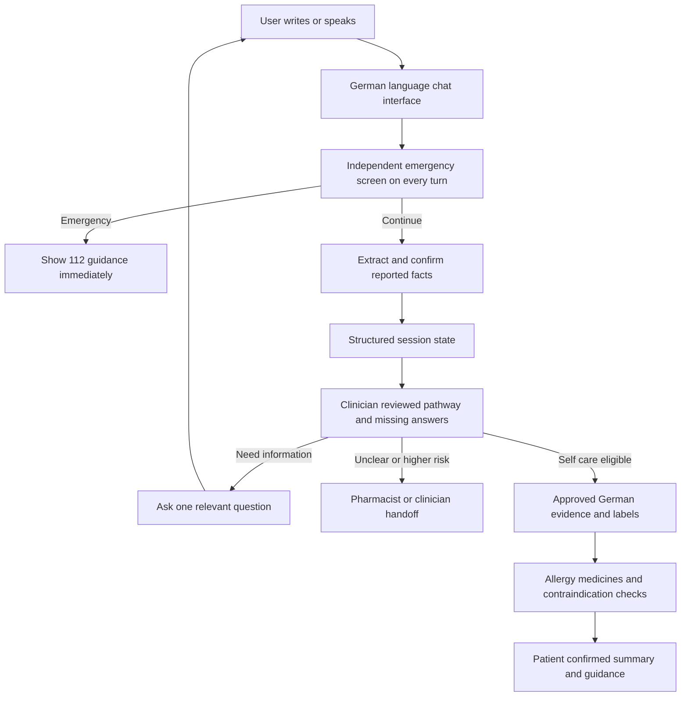

# Purpose and recommendation

This research focuses on a **medical chatbot for Germany**. It uses the two supplied NAF MedAssist PDFs as conversation and testing references. Physical vending, payment and inventory are outside the current scope. Research was conducted on 1–2 November 2026.

**Recommendation:** use the examples as a requirements and test-design starting point, then build a German-language chatbot that asks one relevant question per turn, records uncertain answers accurately, immediately escalates possible emergencies, checks medicine-related risks, and produces a patient-readable summary. Begin with general information and pharmacist/clinician referral. A patient-specific medicine recommendation or dose requires a separate, clinician-approved clinical content process, exact German product information and regulatory assessment.

For the quickest evaluation of an existing commercial triage engine, investigate **Infermedica Platform API** with German structured interviews. For an open-source prototype, evaluate the MIT-licensed **Healthcare Triage Multi-Agent Assistant** as a technical scaffold, but add the missing multi-turn conversation and replace its synthetic clinical content. Use LangGraph/FastAPI as building blocks; do not copy an unlicensed chatbot repository into a commercial product. None of the projects reviewed has been shown to meet all of the supplied scenarios safely and lawfully out of the box.

# What the supplied examples ask the chatbot to do

The two-patient PDF shows (1) a headache with hypertension, losartan and prior hives after ibuprofen that ends in professional review and a patient summary, and (2) a mild headache with an illustrative paracetamol information response. The ten-scenario PDF extends the set with diarrhoea, sore throat, reflux, allergy, a minor wound, sudden severe headache, chest pain and paediatric fever.

The useful feature set is: natural conversation; symptom-specific follow-up; one question at a time; age, medicines, allergies and relevant medical history; emergency detection on every turn; explicit unknown and contradictory answers; a patient-confirmed summary; self-care information where suitable; and clear referral or emergency outcomes. German is the primary deployment language. English, Hindi, Telugu and Kannada were requested in the original brief and can remain optional future languages after separate safety testing.

The PDFs are **illustrative test material**, not proof that a chatbot exists, that a medicine and dose are appropriate for an individual, or that the stated standards have been met. The ten-example PDF's “dispense” labels should be replaced by chatbot outcomes, because dispensing is outside this phase.

# Review of the ten scenarios

| Case | Useful test | Adjustment before using it as an expected result |
|---|---|---|
| 1. Mild headache | Collect onset, severity, warning signs, medicines and relevant history. | The two-example document explicitly calls the paracetamol response illustrative. Treat any medicine and dose as requiring product-specific German label review and clinical approval; do not turn the stated maximum into a universal rule. Split bundled questions into single questions. |
| 2. Headache with losartan and ibuprofen hives | Capture the reported reaction, preserve uncertainty, refer for medication review and produce a patient-confirmed summary. | A review outcome is a sensible conservative test. It does not prove that every person with hypertension or losartan use has the same clinical risk; a clinician must define the underlying criteria. |
| 3. Watery diarrhoea | Ask about dehydration, blood, severe pain, fever and relevant history; discuss hydration and escalation. | **Do not use the PDF's 16 mg daily limit as the German default.** For example, the German professional information for Loperamid AbZ akut 2 mg states a maximum of six capsules, 12 mg daily, for the specified adult use. Product, patient and label must be checked. The sample answer “No, that is not correct / No, none of those” is ambiguous and needs clarification. [Loperamid AbZ product information](https://www.fachinfo.de/fi/pdf/023210/loperamid-abz-akut-2-mg-hartkapseln), [IQWiG diarrhoea information](https://www.gesundheitsinformation.de/durchfall.html). |
| 4. Sudden severe headache | Emergency action should interrupt the interview. | The input reports sudden severe headache and stiff neck, but **does not report fever**. Do not record “fever and stiff neck” as a fact. For Germany display **112** and avoid further nonessential questions. |
| 5. Sore throat | Screen swallowing and breathing and ask relevant follow-ups. | “Antiseptic and anaesthetic lozenges” is not one exact medicine; ingredients, German pack, age restrictions, allergies, interactions and usage differ. No generic dosing rule. |
| 6. Heartburn | Distinguish concerning chest pain from a possible digestive complaint. | Do not assume missing medicines, pregnancy-related information or other risks are negative. The antacid and its maximum need exact German product/label review; interactions can matter. |
| 7. Seasonal allergy | Ask about breathing, throat/tongue swelling and progression; escalate possible severe reactions. | Current medicines, allergies and relevant conditions cannot be inferred as absent. Cetirizine suitability and warnings need patient and product checks, not a fixed response. |
| 8. Superficial cut | Recognize a minor wound and ask about ongoing bleeding, depth, contamination and tetanus protection. | Treat the dressing as a non-medicine example. Do not direct users to put an unspecified antiseptic wipe into an open wound: use the specific product's instructions and clinically reviewed guidance. [IQWiG cuts](https://www.gesundheitsinformation.de/wie-versorge-ich-eine-schnittwunde.html). |
| 9. Chest pressure radiating to arm/jaw with sweating | Immediately interrupt and direct the person to emergency services. | Use **112** in Germany and avoid presenting a definitive diagnosis. Record only symptoms actually reported; an emergency decision should not depend on a missing answer. [German government emergency information](https://gesund.bund.de/en/notaufnahme). |
| 10. Fever in a two-year-old | Route outside the adult-only MVP to a paediatric clinician or pharmacist as appropriate. | Remove the sample's calculated dose and claim that a liquid formulation is universally required. Product formulation, age, weight and concentration require individual review. German patient information describes both liquid and suppository forms. [IQWiG paediatric fever](https://www.gesundheitsinformation.de/fieber-bei-kindern.html). |

Across all cases, a negated symptom (“no chest pain”) must not be stored as present, and an unanswered symptom must not be stored as absent. A “green” result is not evidence of clinical safety. Design the emergency flow for both an unsolicited urgent first message and a red flag revealed during later questions.

# Existing projects and products

Repository metadata was checked on 1–2 November 2026. The selected README and source files were inspected; none of the projects was installed or run for this research. Stars and push dates change. “No licence detected” means commercial reuse permission was not established; it does not mean an open-source licence is implied.

| Project | Match to the NAF examples | Verified limitation and licence | Recommendation |
|---|---|---|---|
| [Healthcare Triage Multi-Agent Assistant](https://github.com/Aamir217/healthcare-triage-multiagent) | Python, FastAPI, LangGraph, Chroma, Neo4j; symptom intake, emergency gate, retrieval and triage. | MIT; last push 19 September 2026. Its README says the protocols and graph are **synthetic**, follow-up questioning and cross-lingual support are missing, and the API lacks authentication. The checked graph calls the LLM intake node **before** the regex emergency gate; the gate uses English patterns. | **Best licensed architecture to evaluate**, with major changes. Put an independently evaluated urgent screen before dependence on the LLM; add one-question state, German sources, medication history and clinician-reviewed rules. [Safety code](https://github.com/Aamir217/healthcare-triage-multiagent/blob/main/src/triage_agent/agents/safety.py), [graph](https://github.com/Aamir217/healthcare-triage-multiagent/blob/main/src/triage_agent/agents/graph.py). |
| [AI Medical Triage Agent](https://github.com/Navyachhoker/symptom-checker) | React, FastAPI, PostgreSQL, LangGraph and Groq; collects symptoms, returns triage and maintains session history. | No licence detected; last push 24 October 2026. Its README says follow-ups occur only when no symptoms were extracted; red flags are English keyword matches and do not handle negation. It describes a simplified, nonvalidated scorer. | **Close UI and API reference**, but not the desired follow-up logic or a reusable commercial codebase without permission. Do not use its scores or emergency rules clinically. |
| [Medical Intake Chatbot](https://github.com/a-agmon/lg-chat-server) | FastAPI, LangGraph and OpenAI; explicitly asks one question per request and returns a structured intake summary. | No licence detected; last push 16 September 2025. The README describes LLM-driven question selection and in-memory session checkpoints; it does not establish a validated emergency or medication safety layer. | **Best conversational-flow reference.** Obtain permission before code reuse; independently build and validate emergency and medication checks. |
| [Multi-Agent Medical Assistant](https://github.com/souvikmajumder26/Multi-Agent-Medical-Assistant) | Python, FastAPI, LangGraph, Qdrant and document retrieval; supports source references and a richer UI. | Apache-2.0; last push 3 May 2025. Its broad feature set includes medical imaging beyond this scope. The checked app mounts uploads as static content; access controls and privacy need review. | **RAG and API reference**, not a ready-to-use clinical chatbot. Keep only needed components and replace clinical assumptions. |
| [PharmaChat](https://github.com/El-denary/PharmaChat) | React, FastAPI, PostgreSQL, LangGraph and Chroma; answers medicine questions using a medicine knowledge base and supports images. | No licence detected; last push 10 July 2026. Its checked sample medicine data contains US-oriented and off-label information, not verified German product labels. Its graph routes retrieval and generation but does not establish a clinical safety engine. | **Medicine Q&A architecture reference only**; obtain reuse rights and replace the data with licensed German sources. |
| [RAG-Based Health Bot](https://github.com/Aragog540/RAG-Based-Health-Bot) | FastAPI, LangGraph, Ollama and Chroma; local PDF ingestion, retrieval, follow-up Q&A and source preview. | No licence detected; last push 9 May 2026. Retrieval and grounding checks do not establish patient-specific medical safety or commercial reuse rights. | **Local RAG reference only**. Obtain permission before reuse and add clinical governance. |
| [PharmaGraphRAG](https://github.com/jmponcebe/PharmaGraphRAG) | Python, FastAPI, Streamlit, Neo4j and Chroma; medicine interaction and adverse-event Q&A using US FDA reports and DailyMed labels. | MIT; last push 20 October 2026. It uses US sources; spontaneous adverse-event reports do not by themselves prove causation or establish rates. [FDA explanation](https://www.fda.gov/drugs/fdas-adverse-event-reporting-system-faers/fda-adverse-event-reporting-system-faers-public-dashboard). | **Drug-information architecture reference**, not a clinical interaction checker for Germany. Replace data and validate coverage and safety. |
| [Healthcare AI Voice Agent](https://github.com/KuchikiRenji/Healthcare-AI-Voice-agent) | React, FastAPI, PostgreSQL, LangGraph and browser speech recognition; voice intake and specialist routing. | MIT; last push 6 February 2026. The README places a Gemini API key in a `VITE_` frontend variable; Vite documents that such values are exposed to client code. Clinical validation and German performance were not established. [Vite documentation](https://main.vite.dev/guide/env-and-mode). | **Voice interface reference** for a later phase; move secrets to the server and replace the clinical logic. |
| [Medical Expert System](https://github.com/UdaraWickramasinghe/Medical-Expert-System) | FastAPI, Experta and Gemini; conversational symptom collection plus a rule-based expert-system example. | No licence detected; last push 4 November 2025. The educational demo presents diagnosis-oriented outputs without evidence of German clinical validation. | **Rules-engine concept reference only**; obtain permission before reuse and do not reuse its diagnostic conclusions. |
| [Medical RAG Chatbot](https://github.com/deepakbsoni/Medical-RAG-Chatbot) | Python/FastAPI middleware, symptom/entity extraction and conversation history. | No licence detected; last push 7 October 2025. Its README assumes a separate LLM backend and uses UK emergency messaging in an example. | **Conversation-memory reference**; obtain permission and independently build German safety and privacy controls. |
| [LangGraph](https://github.com/langchain-ai/langgraph) | Stateful graph framework for one-question conversations, routing and checkpoints. | MIT. It is infrastructure, not a medical chatbot or validated triage system. | **Use as a framework** for a purpose-built chatbot with independent safety checks. |
| [Infermedica Platform API](https://developer.infermedica.com/documentation/overview/) | Commercial symptom interviews, follow-up questions, triage and care navigation. The Platform API lists German interview output. | Proprietary, account and contract required; it is not established as a German product-specific OTC dosing system. Its separate Engine API FAQ describes its free-text `/parse` service as English-only; do not assume German free-text parsing from German structured-question support. | **Best commercial evaluation candidate.** Verify German free text, product scope, clinical validation, contractual use, pricing and data handling. [Language settings](https://developer.infermedica.com/documentation/platform-api/basics/settings/), [Engine API FAQ](https://developer.infermedica.com/documentation/engine-api/faq/). |

**Practical combination:** start with FastAPI + LangGraph and the MIT triage project's architecture as a learning reference, not its sample clinical data. Add a clinician-approved symptom state machine, reviewed German medical content, a product-information service, patient-confirmed summary, security and a separate safety layer. Alternatively, evaluate Infermedica for the interview component and retain independent governance over the final medical information and escalation rules.

# n8n examples relevant to the chatbot

n8n can support notifications or evidence-ingestion experiments, but the clinical decision boundary should remain in a versioned and testable backend. These are public template descriptions; their JSON was not inspected or executed here.

| Template | What to learn | Change needed |
|---|---|---|
| [5920 Medical symptom checker](https://n8n.io/workflows/5920-medical-symptom-checker-and-health-assistant-with-gpt-4-mini/) | Chat and emergency-keyword workflow. | Replace keyword-only triage, use German emergency guidance and add validated independent rules. |
| [7179 Symptom analysis and doctor suggestions](https://n8n.io/workflows/7179-medical-symptom-analysis-and-doctor-recommendations-with-ollama-ai-and-whatsapp/) | Form/chat intake and referral messaging. | Remove model-only triage and avoid sending health data to WhatsApp or email without a lawful, approved integration. |
| [18790 Hospital chatbot with Mistral and Supabase](https://n8n.io/workflows/18790-run-an-ai-hospital-triage-and-booking-chatbot-with-mistral-and-supabase/) | Conversation, retrieval and escalation. | Replace model-driven severity decisions; constrain database access and use approved clinical content. |
| [3670 Medical Q&A with RAG](https://n8n.io/workflows/3670-medical-qanda-chatbot-for-urology-using-rag-with-pinecone-and-gpt-4o/) | Medical-document question answering and references. | Replace the domain content with licensed German material and add source freshness and patient safety checks. |
| [6345 Supabase document RAG](https://n8n.io/workflows/6345-answer-questions-from-documents-with-rag-using-supabase-openai-and-cohere-reranker/) | Document ingestion, embeddings and reranking. | Requires self-hosted community nodes; add clinical review and do not let retrieval authorize treatment. |

n8n Community is offered under a Sustainable Use License; assess the exact commercial and embedding use with the vendor. Template availability does not establish a right to redistribute external content or a clinically safe workflow. [n8n licensing FAQ](https://support.n8n.io/article/can-i-use-your-license-for-my-use-case).

# German medical content and safety resources

| Source | Suitable use | Restriction |
|---|---|---|
| [gesund.bund.de](https://gesund.bund.de/) | German government health information, patient education and local care navigation. | Review current source and reuse rights. It is not a patient-specific recommendation engine. |
| [Gesundheitsinformation.de / IQWiG](https://www.gesundheitsinformation.de/) | Patient-readable condition and treatment information. | Use clinically reviewed context and check content rights before ingestion or translation. |
| [AWMF guidelines](https://register.awmf.org/) | German clinical practice guidelines for clinician review; select the current guideline and update status for each pathway. | Clinician-oriented guidance must be adapted and tested before patient-facing use. |
| [BfArM](https://www.bfarm.de/DE/) and [EMA medicine data](https://www.ema.europa.eu/en/medicines/download-medicine-data) | Regulatory information, notices and applicable product information. | Check product identity, update coverage and rights; public medicine data is not automatically an interaction-checking API. |
| [ABDATA medicine database](https://abdata.de/produkte/abdadatenbank2/) and [AMTS module](https://abdata.de/produkte/abdadatenbank2/amts-modul/) | German medicine and interaction information for a possible commercial integration. | Confirm licence, price, interface, coverage, updates and whether the intended chatbot use is permitted; no API or pricing claim is assumed here. |
| [IFA PZN information](https://www.ifaffm.de/mandanten/1/documents/02_ifa_anbieter/richtlinien/IFA-Guidelines_Data-Notification_EN.pdf) | PZN identifies a specific German market product/pack and helps match medicine history. | A PZN is an identifier, not a safety assessment or proof a product can be recommended. Obtain the required data rights. |

For emergencies in Germany, use **112**. For urgent but non-life-threatening medical help, **116117** can direct people to the appropriate service. These have different purposes. [German government emergency guidance](https://gesund.bund.de/notaufnahme).

# Recommended chatbot design

**Minimum state:** `complaint`, `onset`, `duration`, `severity`, `associated_symptoms`, `age`, `medical_conditions`, `allergies_and_reactions`, `current_medicines`, `pregnancy_or_breastfeeding_if_relevant`, `red_flags`, `unknown_fields`, `language`, `triage_result`, `source_versions` and `summary_confirmed`. Record whether each finding was reported present, explicitly absent, unknown or not yet asked. A user correction invalidates any earlier conclusion that depended on the changed answer.

**Suggested result types:** `EMERGENCY`, `URGENT_REVIEW`, `PHARMACIST_OR_CLINICIAN_REVIEW`, `NEED_MORE_INFORMATION`, `SELF_CARE_INFORMATION`, and, only in a later clinically approved stage, `PRODUCT_INFORMATION_ELIGIBLE`. A result is not a diagnosis. Do not use LLM self-reported confidence to mark a case safe.

**Medicine layer:** map user-reported names and combinations to their active ingredients, confirm ambiguous names, check for duplicate ingredients and relevant contraindications/interactions, and treat missing data or service failure as unknown. Information shown about a specific medicine must come from the correct current German product information and be reviewed for the intended user. If there is no clinically approved rule or product match, refer to a pharmacist; never invent a dose or approve a prescription medicine.

**Privacy and regulation:** health information is special-category personal data under the GDPR. Determine the controller, a lawful basis under Article 6 and an applicable Article 9 condition, notices, access, retention, security, processor contracts and any transfer safeguards with a qualified adviser; assess whether a data protection impact assessment is required. Separately assess whether the chatbot's actual medical intended purpose makes it medical-device software under EU MDR, with classification and conformity obligations if applicable. Disclaimers do not determine the classification. [GDPR](https://eur-lex.europa.eu/eli/reg/2016/679/oj/eng/), [European Commission software guidance](https://health.ec.europa.eu/latest-updates/update-mdcg-2019-11-rev1-qualification-and-classification-software-regulation-eu-2017745-and-2025-06-17_en). Check the EU AI Act according to the product's role, classification and current applicability dates.

# Test plan before any real patient use

Use the ten cases as a **small starting set**. Ask a German clinician and pharmacist to specify the expected urgency, missing questions, permitted content and reason codes for each case. Add cases for negations, contradictions, incomplete medication lists, repeated questions, changes of mind, language switching, similar drug names, duplicate active ingredients, missing age, pregnancy or breastfeeding when relevant, and new red flags introduced mid-conversation.

Test severe headache and chest-pain cases in German and English with typos, indirect wording, speech transcription mistakes and negations. Check that emergency guidance appears promptly even if an LLM, retrieval source or external API is unavailable. Separately test German product identity and label limits, allergies, interactions, under-18 routing, missing information and requests for prescription-only medicines. Evaluate every supported language independently.

Measure emergency under-triage, over-referral, incorrect medicine information, hallucinated facts, failure to ask required questions, summary accuracy and clinician agreement; report the test population and confidence intervals. Do not infer real-world safety from ten passing examples. Use synthetic records during development, then conduct a separately governed clinical and usability evaluation before real patient use.

# First steps

1. Agree the intended German deployment, target user age, languages and whether the first version gives general medicine information or individualized recommendations.
2. Have a German clinician and pharmacist correct and approve the ten examples, including the exact product information where medication is involved.
3. Evaluate the MIT triage scaffold and Infermedica with synthetic cases. Inspect licence, data flows and integration agreements before committing to either.
4. Implement a one-question conversation with structured state, immediate emergency interruption, uncertainty handling and a patient-confirmed summary.
5. Add licensed German knowledge and pharmacist-reviewed medication checks; keep individualized medicine advice off until its clinical and regulatory basis is established.
6. Validate German-language safety, privacy and clinical performance before expanding to the original brief's additional languages.
