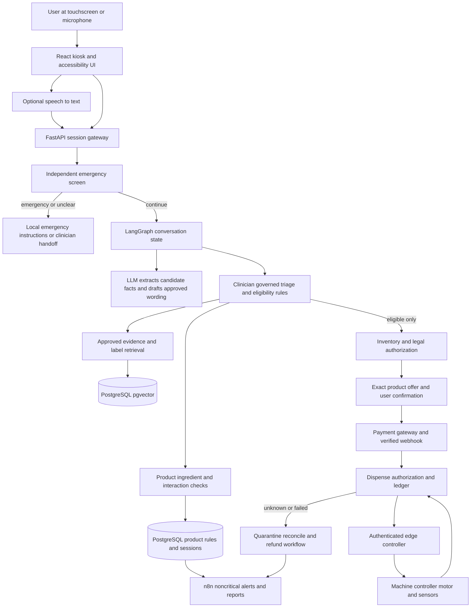

> **Superseded for this project:** The requested scope is now a chatbot for Germany. See [NAF MedAssist chatbot research for Germany](NAF_MedAssist_Germany_Chatbot_Research.md). The India and vending material below is retained only as an earlier reference.

# Decision and recommended MVP

Research for an India-first, multilingual symptom-assessment and medicine-vending system. Evidence checked on 1 November 2026. This is an engineering and research specification, not an approved treatment protocol or legal clearance.

Build an adult, text-first, pharmacist-connected kiosk in a licensed clinical or pharmacy pilot. Start with headache, cold or sore throat, and indigestion; provide clinician-approved self-care and referral information. Demonstrate inventory, payment and delivery using test products and a hardware simulator. The first live product catalogue should contain only individually reviewed non-medicine products whose sale and dispensing route are confirmed for that site. Add medicines only after product-specific clinical approval, an interaction-checking solution, and written state-level regulatory confirmation. Products that appear to be “OTC” in another country are not automatically eligible for unattended sale in India.

Use an LLM for language understanding and phrasing, a clinician-owned rules service for triage and product eligibility, and a separate dispensing service that enforces authorization. No agent, workflow, or retrieved passage may override a red flag, substitute a product, infer a missing safety answer, or directly actuate a motor. A pharmacist or clinician must be available for the pilot; remote supervision is not assumed to satisfy any legal requirement.

The strongest technical reuse candidates are [LangGraph](https://github.com/langchain-ai/langgraph), [FastAPI](https://github.com/fastapi/fastapi), [pgvector](https://github.com/pgvector/pgvector), and carefully isolated examples from [Multi-Agent Medical Assistant](https://github.com/souvikmajumder26/Multi-Agent-Medical-Assistant). None supplies a validated India-specific treatment or vending pathway. n8n is best reserved for noncritical operational workflows, not the clinical or payment-to-motor safety boundary.

## Evidence and uncertainty

The cited laws and clinical sources establish useful constraints, but they do not establish that a specific kiosk, product, pharmacist arrangement, or AI use is lawful and clinically safe. The system design, phased MVP, example fields, and proposed acceptance criteria below are recommendations. Vendor descriptions establish advertised functionality, not independently verified outcomes. Repository ratings are for investigation, not endorsements of patient safety. Prices, stars, forks, maintenance and product availability can change.

Studies show why local validation matters: a 2025 vignette study of one symptom checker reported 94% safety across 390 included trials, while a 2024 evaluation of another CDSS reported 19% under-triage across its vignette set. Neither estimate predicts this kiosk's performance. A 2026 systematic review calls for rigorous real-world evaluation of LLM use. [Swedish vignette study](https://pubmed.ncbi.nlm.nih.gov/40982722/), [national helpline CDSS evaluation](https://pubmed.ncbi.nlm.nih.gov/38269862/), [LLM and clinician review](https://pubmed.ncbi.nlm.nih.gov/41652180/).

# Indian regulatory and privacy gates

## What is established

- **Drug sale and prescriptions.** The Drugs and Cosmetics Act and Rules regulate drug sale and licensing. The Rules impose prescription-related controls for Schedule H, H1 and X drugs; schedule status, formulation, strength, pack, claims and later amendments all matter. The Pharmacy Act section 42 addresses compounding or dispensing medicine on a medical practitioner's prescription by a registered pharmacist, subject to its stated exceptions. Requirements in the Drugs Rules, licence conditions, and applicable pharmacy practice rules must also be considered. [CDSCO legislation compilation](https://www.cdsco.gov.in/opencms/export/sites/CDSCO_WEB/Pdf-documents/acts_rules/2016DrugsandCosmeticsAct1940Rules1945.pdf), [Pharmacy Act section 42](https://www.indiacode.nic.in/bitstream/123456789/19163/1/pharmacy_act_1948.pdf), [Pharmacy Practice Regulations](https://upload.indiacode.nic.in/showfile?actid=AC_CEN_12_13_00008_194808_1517807321458&filename=9.+The+Pharmacy+Practice+Regulations%2C+2015.pdf&type=regulation).
- **No blanket vending clearance established.** A drug not listed as prescription-only is not thereby shown to be legally vendible without staff. This research did not establish a general national permission, a definitive list of medicines for unattended machines, or that a remote pharmacist satisfies local supervision requirements. Non-drug items also require correct classification and site-specific review.
- **Possible software/device regulation.** CDSCO's medical-device scope includes software intended for specified medical purposes, and CDSCO publishes software classification and guidance. Applicability and class depend on the actual intended purpose, claims, architecture and risk. Obtain a written classification assessment; do not assume that an informational disclaimer changes the intended purpose. [CDSCO medical devices and diagnostics](https://cdsco.gov.in/opencms/opencms/en/Medical-Device-Diagnostics/Medical-Device-Diagnostics/).
- **Data protection.** The Digital Personal Data Protection Rules, 2025 were notified with staged commencement: rules 1, 2 and 17–21 on publication; rule 4 after one year; and rules 3, 5–16, 22 and 23 after 18 months. On the research date, much of that latter group had not yet commenced under that notification; check corrigenda, later notifications, the Act's separate commencement schedule, and other applicable laws. Adopt appropriate notice, lawful basis, minimization, security, retention, deletion, incident response and vendor controls in the design now. [MeitY gazette](https://www.meity.gov.in/static/uploads/2025/11/53450e6e5dc0bfa85ebd78686cadad39.pdf), [MeitY rules and commencement materials](https://www.meity.gov.in/documents/act-and-policies/digital-personal-data-protection-rules-2025-gDOxUjMtQWa?pageTitle=Digital-Personal-Data-Protection-Rules-2025%3B).
- **Emergency number.** India’s national emergency response service lists **112** for police, fire and medical emergencies. The kiosk should display its own location and offer an accessible way to call; verify local handoff procedures. [ERSS](https://112.gov.in/).

## Questions for a state drug controller, registered pharmacist and Indian regulatory lawyer

1. For the exact site, who holds the retail drug licence and what premises, staffing, hours, storage and inspection conditions apply? Is a vending unit within or outside the licensed premises? Does every unit need a separate licence?
2. Can the particular product and pack be sold from that machine, by whom, and with what physical or remote pharmacist supervision? Are there relevant central or state notifications, Schedule K exemptions, local orders or special product restrictions?
3. For any future prescription pathway, what prescription validation, pharmacist review, labelling, records, identity and counselling are required? No such pathway is part of this MVP.
4. Is the intended symptom triage or product recommendation software a regulated medical device, and which classification, licence, quality system and post-market duties apply? Does the hardware or a particular component require separate approval?
5. What consent or other lawful basis, notice languages, child-data handling, retention period, hosting/transfer arrangements, contracts, security and incident reporting apply to the deployment as launched?
6. Which official state contact, emergency referral service and complaint escalation path should the machine show? Preserve the written answers, date, responsible authority and exact product list as deployment evidence.

# Clinical knowledge and condition pathways

The following are **research starting points**, not executable rules. Each pathway needs a clinician-approved decision tree, precise timing, thresholds and referral language adapted for the setting. Red flags below are examples, not exhaustive exclusion criteria. Under the proposed adult-only MVP, children, pregnancy or breastfeeding where relevant, serious comorbidity, uncertain allergy or medication history, inability to communicate, or unresolved risk result in pharmacist/clinician review rather than a product recommendation. The user can still receive immediate emergency instructions.

| Concern and likely presentation | Follow-up questions to research | Examples requiring escalation | General self-care and potential product pathway |
|---|---|---|---|
| Headache: recent head pain, pressure or ache | Onset and duration? Sudden or gradual? Severity, injury, fever, vomiting, vision, weakness or speech changes? | Sudden extremely severe headache, new weakness or confusion, seizure, serious injury, or headache with fever/stiff neck: emergency. Persistent or recurrent/worsening pain: assessment. | Hydration, rest and avoiding missed meals may help. A pain-relief category is a **future** candidate only after full safety and legal checks. [NHS headache](https://www.nhs.uk/symptoms/headaches/). |
| Fever: feeling hot, chills, measured high temperature | Duration and measured temperature? Rash, breathing problems, confusion, dehydration or travel/exposure? Underlying disease? | Severe breathing difficulty, confusion or other acute danger: emergency. Fever worsening or not improving needs clinical assessment; locally relevant dengue/malaria protocols need clinician review. | Fluids and rest; future symptom relief depends on cause, label and person. [NHS fever in adults](https://www.nhs.uk/symptoms/fever-in-adults/), [ICMR standard treatment workflows](https://www.icmr.gov.in/icmrobject/custom_data/pdf/downloadable-books/STW_Manual_v1.pdf). |
| Cold and cough: runny nose, sneezing, cough | Duration, breathlessness, chest pain, fever, mucus or blood? Which cold remedies already taken? | Severe breathing difficulty, concerning chest pain or coughing blood: urgent/emergency pathway as clinically assessed; prolonged or worsening symptoms need review. | Rest and fluids; no automatic antibiotics or multi-ingredient cold products. Verify duplicate active ingredients. [NHS common cold](https://www.nhs.uk/conditions/common-cold/), [NHS cough](https://www.nhs.uk/symptoms/cough/). |
| Sore throat: pain, discomfort swallowing | Duration, ability to swallow fluids, fever, breathing or drooling? | Difficulty breathing, inability to swallow, drooling or rapidly worsening symptoms: emergency. | Fluids, rest and soft/cool foods; approved non-drug products may be assessed. [NHS sore throat](https://www.nhs.uk/symptoms/sore-throat/). |
| Indigestion: burning after food, fullness or sour reflux | Location, onset, exertional pattern, sweating/breathlessness, swallowing, vomiting blood or black stool? | Persistent chest pressure/burning, spreading pain, sweating or breathlessness: emergency; difficulty swallowing or bleeding: urgent assessment. Do not label chest pain as acidity based on a user guess. | Avoid personal triggers and late meals. Antacid category only after a pharmacist reviews interactions, contraindications and Indian product status. [NHS indigestion](https://www.nhs.uk/conditions/indigestion/), [NHS chest pain](https://www.nhs.uk/symptoms/chest-pain/), [NHS swallowing problems](https://www.nhs.uk/symptoms/swallowing-problems-dysphagia/). |
| Diarrhoea: frequent loose stool, possibly vomiting | Duration, blood, severe pain, fluid intake, urine output, fever and recent travel? | Blood in stool, signs of significant dehydration, severe persistent pain or inability to keep fluids down require prompt assessment; emergency symptoms follow the emergency pathway. | Rehydration is central; suitable oral rehydration product may be assessed after classification and label review. Do not routinely suggest antibiotics or an anti-diarrhoeal. [NHS diarrhoea and vomiting](https://www.nhs.uk/symptoms/diarrhoea-and-vomiting/), [ICMR antimicrobial guidance](https://www.icmr.gov.in/icmrobject/custom_data/pdf/resource-guidelines/Treatment_Guidelines_2019_Final.pdf). |
| Constipation: hard stool, straining or change from usual | Duration, abdominal pain, vomiting, blood, medicines and bowel habit change? | Severe abdominal pain/distension with vomiting or inability to pass stool/gas warrants prompt assessment; blood or persistent change needs medical review. | Fluids, activity and dietary changes where appropriate; laxatives need product-specific review. [NHS constipation](https://www.nhs.uk/conditions/constipation/). |
| Mild allergy: itchy eyes, sneezing or localized itchy rash | Trigger, onset, spread, prior reactions, breathing/swallowing or lip/tongue swelling? | Sudden tongue/throat swelling, trouble breathing or faintness: emergency. | Avoid the suspected trigger; antihistamines are a future candidate only after contraindication, sedation and interaction checks. [NHS allergies](https://www.nhs.uk/conditions/allergies/). |
| Muscle pain: localized ache after activity | Onset, injury, location, swelling, weakness and ability to move? | Serious injury, marked weakness, severe swelling or other systemic danger needs clinical assessment; emergency when severe. | Rest and gentle self-care per clinician-reviewed pathway. Do not assume pain is muscular from text alone. [NHS sprains and strains](https://www.nhs.uk/conditions/sprains-and-strains/). |
| Mild skin irritation: localized itchy or dry skin | New exposure, location, spread, blistering, infection, face/eye involvement? | Rapid spread, major blistering, systemic illness or breathing symptoms require urgent assessment; severe allergy is an emergency. | Avoid the suspected irritant; consider a non-medicated emollient if suitable and legally cleared. [NHS contact dermatitis](https://www.nhs.uk/conditions/contact-dermatitis/). |
| Minor first aid: superficial cut or graze | Wound depth, bleeding, contamination, foreign body, bite and tetanus history? | Uncontrolled bleeding, deep wounds, embedded objects, bites or infection concerns need medical assessment at a clinically appropriate urgency. | Clean and cover a minor wound; a suitable dressing may be a candidate. Do not remove an embedded object. [NHS cuts and grazes](https://www.nhs.uk/conditions/cuts-and-grazes/). |

NHS pathways describe UK services and local product classification; translate the clinical evidence and referral destinations through an Indian clinician. ICMR treatment workflows are for health professionals and must not be converted into autonomous prescriptions. NICE guidelines, WHO guidance, MedlinePlus, PubMed-indexed studies, Indian Ministry of Health guidance, CDSCO notices and manufacturer-approved Indian labels should be assessed for intended use, date and content rights before ingestion. [NICE acute cough](https://www.nice.org.uk/guidance/ng120/chapter/Recommendations), [NICE acute sore throat](https://www.nice.org.uk/guidance/ng84/chapter/Recommendations), [NICE dyspepsia](https://www.nice.org.uk/guidance/cg184/chapter/Recommendations), [WHO publications](https://www.who.int/publications), [ICMR resources](https://www.icmr.gov.in/), [PubMed](https://pubmed.ncbi.nlm.nih.gov/), [Ministry of Health](https://www.mohfw.gov.in/).

## Conversation examples

**Headache:** User: “I have a headache.” Kiosk: “Did it start suddenly and become extremely severe?” If yes, or if another emergency sign is volunteered, stop the interview, give the local emergency instruction and do not offer a product. If no, ask one relevant question at a time about onset, associated symptoms and remaining required safety fields. An unclear answer remains unknown.

**Cold and cough:** User: “I have a cough.” Kiosk: “Are you having severe trouble breathing?” Continue only on a clearly negative answer. Ask the relevant duration and associated-risk questions, then offer only approved self-care or a reviewed referral; product eligibility requires the separate rules service.

**Acidity:** User: “I have acidity.” Kiosk: “Do you have chest discomfort that is severe or does not go away?” If the user describes persistent pressure, spreading pain, sweating or breathlessness, immediately route to emergency care. Do not propose an antacid while triage is unresolved.

# Existing symptom assessment services

| Service | Documented interaction and assessment | Medicine guidance, safety and fit |
|---|---|---|
| [Ada Health](https://ada.com/help/how-do-i-start-a-symptom-assessment/) | User supplies symptoms and profile details; adaptive questions feed expert-curated probabilistic reasoning and possible causes. | Ada says it is not a treatment service or diagnosis; it provides safety-netting and notes its consumer app is EU Class IIa. It is a triage reference, not an India vending authorization. [Purpose and safety](https://ada.com/help/what-degree-of-liability-does-ada-accept/), [treatment statement](https://ada.com/help/does-ada-provide-medical-treatments/). |
| [Buoy Health](https://www.buoyhealth.com/how-it-works) | Symptom and demographic intake followed by an AI-guided interview and care navigation; detailed model and question logic are proprietary. | General care guidance and referrals are described; specific independent OTC selection was not established. Assess product scope and regional availability with the vendor. [Buoy interview FAQ](https://bannerhealth.buoyhealth.com/support/). |
| [K Health](https://khealth.com/) | AI intake asks symptoms and triages; provider describes a separate agent presenting candidate diagnoses and plans to a physician for final review. | Physician-directed treatment/prescriptions are distinct from autonomous OTC vending. Vendor and licensed-clinician roles depend on the service. [K Health description](https://khealth.com/wp-content/uploads/2025/04/K-HEALTH-BLOG-POST-3.31.25.pdf). |
| [Babylon / eMed UK](https://www.emed.com/uk/terms-of-use) | Historical symptom checker and telehealth; eMed material describes symptom assessment and provider services. | Babylon's former business arrangement should not be assumed to be currently available. Verify current eMed service and market before integration; no autonomous vending established. [eMed support](https://support.babylonhealth.com/cspbabylonsupport?id=csp_kb_article_view&sysparm_article=KB0010121). |
| [Your.MD / Healthily](https://www.healthily.ai/) | Health navigation and assessment; Your.MD is the former company name. | The company says its mobile app operation was licensed to Webron; verify the specific product and data controller. No product-specific autonomous dispensing established. [Healthily notice](https://www.healthily.ai/legal-pages/notice-regarding-our-mobile-application). |
| [Mediktor](https://www.mediktor.com/) | Free-text symptoms and successive questions lead to care-level guidance. The vendor describes NLP/ML and an LLM layer through Amazon Bedrock. | Clinical safety and commercial terms require due diligence; published descriptions do not establish autonomous Indian OTC sales. [Implementation description](https://www.mediktor.com/zh-cn/news/press/columbia-memorial-health-launches-the-regions-first-digital-symptom-checker-powered-by-mediktor-to-aid-patients-in-efficiently-triaging-their-symptoms-and-quickly-accessing-the-mos), [AI agent](https://site.mediktor.com/ai-medical-agent). |
| [Infermedica](https://developer.infermedica.com/documentation/overview/) | API accepts symptoms, risk factors and demographics, asks further questions, and returns possible conditions and a triage level using statistical inference. | The API says it is not intended for diagnosis or treatment. India language coverage, clinical fit, licensing, data processing and any downstream product recommendation need separate agreements and validation. [API limitations](https://developer.infermedica.com/documentation/engine-api/build-your-solution/diagnosis/). |
| [NHS 111 online](https://111.nhs.uk/) | User answers a structured symptom assessment and receives next-step care navigation. | It explicitly says it does not diagnose. UK service and pathways cannot simply be deployed as an India medicine selector. |
| [WebMD](https://symptoms.webmd.com/aisc) | Symptom entry and condition information; its app also lists medicine information and warnings. | Information and symptom checking are not evidence of an individually authorized OTC vending decision. [WebMD app description](https://customercare.webmd.com/hc/en-us/articles/19689436362509-Tell-me-about-the-core-WebMD-App). |

Only Ada, Infermedica, Mediktor and K Health have a model/technology detail directly established above. For the others, exact model, question-selection method and medication recommendation coverage should be treated as undisclosed unless a current vendor contract or documentation says otherwise. A successful triage integration still needs the independent contraindication, interaction, product, legal and dispensing checks described below.

# Vending, pharmacy automation and kiosk comparisons

The table distinguishes an advertised commercial offering from a research prototype. “Not established” means the cited source did not establish the feature; it is not proof the feature does not exist. Country is the source's operating or product context, not a verified full deployment list.

| Product or company | Type and geography | Documented capability | Gap relative to the proposed kiosk |
|---|---|---|---|
| [InstyMeds](https://www.instymeds.com/system/overview/) | Commercial, US | Point-of-care automated dispensing of prescribed medicines; a valid prescription is required. | Not evidence of autonomous symptom-to-OTC selection; US rules do not confer Indian permission. [FAQ](https://www.instymeds.com/faq/). |
| [Asteres ScriptCenter](https://asteres.com/products-and-services/) | Commercial, US | Secure pickup of pharmacy-filled, checked and counselled prescriptions and OTC items; payment and pickup automation. | Pharmacy retains clinical and filling control; no symptom chatbot established. |
| [VendRx](https://vendrx.net/) | Commercial offering, US | A partner pharmacy verifies medicines for secure release in a clinical location. | A verified-prescription workflow is different from independent product selection. |
| [MedAvail MedCenter](https://www.sec.gov/Archives/edgar/data/1402479/000162828022017987/medavail-424b3.htm) | Historical commercial example, US/Canada | SEC filing describes self-service kiosk, pharmacy management, backend monitoring and pharmacist support. | Historical filing is not proof of current availability, ownership or operation; no autonomous symptom-to-product pathway established. |
| [BD Pyxis MedFlex](https://www.bd.com/en-us/products-and-solutions/products/product-families/pyxis-medflex) | Commercial clinical cabinet, US product context | Controlled storage and access to medications and supplies in care settings. | Staff-facing dispensing cabinet, not a public symptom chatbot. |
| [Omnicell XT](https://www.omnicell.com/points-of-care/xt-automated-dispensing-cabinet/) | Commercial clinical cabinet, US product context | Automated medication and supply cabinet with inventory visibility. | Clinical staff workflow; no patient-facing symptom-guided vending established. |
| [Terraform Healthcare Technologies](https://terraform.care/) | Commercial offering, India | Vendor describes medicine automation, visual inspection and configurable patient-facing vending. | Confirm deployment, legal route, pharmacist workflow and product capabilities; symptom-based selection not established. |
| [BVC Smart Medicine Vending Machine](https://bvc24.com/smart-medicine-vending-machine.php) | Commercial offering, India | Vendor advertises touchscreen and payment for medicine vending. | No clinical AI, supervision or site authorization established on the cited page. |
| [Cloudspital Health ATM](https://www.cloudspital.ai/) | Commercial health kiosk offering, India | Vendor describes vital measurements, health records and doctor teleconsultation. | Medicine vending and autonomous selection not established. |
| [RAHA Digital Healthcare Kiosk](https://raha.aspagteq.in/) | Commercial offering, India | Vendor describes a healthcare kiosk and medicine integration into telemedicine. | Specific dispensing, regulatory and AI features require direct verification. |
| [HERMES](https://arxiv.org/abs/2504.13880) | Research prototype, 2025 paper | Authors describe an AI kiosk for personalized OTC recommendations and a survey of 10 medical professionals. | Small professional survey and preprint do not establish real-world safety, legal permission, commercial availability or the reliability of physical dispensing. |
| [AI-powered medical vending machine](https://www.ijsat.org/research-paper.php?id=4453) | Research proposal, India | The paper describes a symptom-related AI and automated-dispensing concept. | A proposal is not evidence of clinically validated deployment or lawful unattended sales. |

**Opportunity:** integrate evidence-controlled triage, auditable pharmacist oversight, Indian-language interaction, product-level legal controls and reliable vend reconciliation. The HERMES and Indian research proposals show that combining symptom-based recommendation and dispensing is not a wholly novel concept; commercial deployment of that exact combination was not verified here.

# Medicine recommendation and safety engine

## Compare approaches

| Method | Benefit | Limitation and recommended role |
|---|---|---|
| Deterministic decision tables | Auditable, testable, reproducible gates | Coverage and maintenance are hard; clinicians must author and approve all rules. Use for emergency routing, mandatory fields, product eligibility and hard exclusions. |
| Traditional clinical decision support | Structured concepts and clinically maintained protocols | Requires valid local evidence, patient-specific coverage and independent validation. Use versioned rules and approved terminology; do not equate a rule engine with a validated clinical device. |
| Knowledge graph | Connects ingredient, formulation, interaction, indication and source | Complex mapping and incomplete edges can imply false safety. Useful as a curated relationship store, not an autonomous decision-maker. |
| LLM alone | Natural conversation and multilingual explanation | Hallucination, missed red flags, fabricated doses and non-determinism make unsupervised selection unsafe. Do not use as the authority for treatment or safety. |
| Hybrid | Flexible language interface plus reproducible gates and clinician review | Requires strict contracts, governance and end-to-end testing. Recommended: allow the LLM to extract candidate facts and generate constrained explanations; rules and humans decide eligibility. |

## Fail-closed decision contract

1. **Emergency screen at every turn.** Independently evaluate the entire latest user utterance and structured history for red flags, including unsolicited and corrected facts. An emergency route interrupts questioning, shopping and payment; it gives an immediately visible local action. A clinician-reviewed multilingual phrase/structured screen can complement, but cannot prove the completeness of, an LLM extractor.
2. **Triage and scope.** Required observations use `present`, `absent`, `unknown`, or `not_asked`, with provenance and time. Do not convert unknown to absent. If a user cannot answer, if messages contradict, or the complaint falls outside approved pathways, offer a clinician/pharmacist handoff. Escalation cannot be weakened by an LLM-generated summary.
3. **Medication reconciliation.** Confirm age, condition-specific factors, allergies and current medicines, including recent non-prescription and combination products, relevant pregnancy/breastfeeding status, and clinician-specified health conditions. Map each reported product to its active ingredients and strengths, with user confirmation; unresolved brands or allergies trigger review. Record a reasoned “not applicable” where a question genuinely does not apply.
4. **Candidate generation.** The rule service produces a small set of *categories* or products from the clinician-approved catalogue, only for explicitly supported symptoms. Then validate each ingredient, strength, dosage form, route, product-specific indications, age and other restrictions, condition and allergy exclusions, duplicate ingredients, interactions, label, source and expiry.
5. **Interaction and legal gates.** A licensed, clinically curated interaction source with India-relevant coverage checks all current medicines against all proposed ingredients. Also check product-to-product duplication, allergies, relevant diseases and route. Treat unknown identity, inadequate coverage, timeout, stale content, or a clinically significant result as `REVIEW_REQUIRED` or `NO_PRODUCT`, never as a negative result. The jurisdiction and site authorization record must explicitly allow the product, pack and manner of sale.
6. **Inventory gate.** Candidate must match machine, slot, batch, expiry, temperature/storage state, recall/quarantine status and available unreserved stock. Recheck immediately before payment and dispensing. A mismatch results in no vend and reconciliation, not substitution.
7. **Explain and confirm.** Show the exact eligible product, purpose, label-derived usage and age restrictions, contraindications, important side effects, safety-netting and traceable source; pharmacist-approved language and translations only. Never invent a dose or use a foreign product label as the Indian pack's authorization. Require explicit user confirmation, with a route to a pharmacist.
8. **Authorize hardware separately.** A short-lived authorization binds session, product, batch, slot, machine, rule version, inventory reservation, price, user confirmation and verified payment. An independent backend, not the LLM or n8n, verifies it before issuing a one-time command. Revalidation failure expires the offer and starts the appropriate refund/reversal process.

Suggested decision results: `EMERGENCY`, `URGENT_REVIEW`, `CLINICIAN_REVIEW`, `MORE_INFORMATION`, `SELF_CARE_ONLY`, `ELIGIBLE_PRODUCTS` or `NO_PRODUCT`. Include reason codes and rule/source versions. A self-care result is not a medical diagnosis and is allowed only after the required pathway checks pass. Set versioned rule effective/expiry dates and define who can publish or revoke rules.

## Governance and testing

Maintain a clinical safety case, hazard log, risk ownership, conflict-of-interest controls, incident reporting, change-control board, source inventory and clinical reviewer sign-off. Map each rule to a source, scope, exact product, approver, effective date, review date and unit/property tests. Maintain golden cases for emergency signs, look-alike drug names, duplicate ingredients, pregnancy, children, missing answers and adversarial input. Evaluate human factors and health literacy, disability access and multilingual performance with representative Indian users before rollout.

Do not use an LLM's confidence or retrieval similarity as a clinical safety score. Measure the full pipeline, including speech and translations; report emergency under-triage separately from over-referral and no-answer rates. Establish acceptable limits with clinicians before testing and report uncertainty, subgroup denominators and external validation. As an illustration, even zero failures in 300 independent, representative high-risk cases leaves an approximate 95% upper bound around 1%; this does not cover unseen case types or replace a real-world safety study.

# Medicine knowledge sources and database

| Source | Content and interface | Costs, licensing and limits for this project |
|---|---|---|
| [RxNorm / RxNav](https://www.nlm.nih.gov/research/umls/rxnorm/faq.html) | Normalized US drug names, identifiers, ingredients, strengths and classes; REST APIs. Useful for normalization and duplicate ingredient mapping, not a complete interaction checker. | NLM does not charge for RxNorm licensing; full releases require a free UMLS licence and may contain source-specific proprietary restrictions. Commercial users follow the same terms. Mostly US drugs. [Terms](https://www.nlm.nih.gov/research/umls/rxnorm/docs/termsofservice.html). RxNav's drug–drug interaction feature was **discontinued on 2 January 2024**. [NLM FAQ](https://www.lhncbc.nlm.nih.gov/RxNav/information/FAQs.html). |
| [DailyMed](https://www.dailymed.nlm.nih.gov/dailymed/app-support-web-services.cfm) | REST API to US structured product labels, which can include indications, dosing, contraindications, adverse effects and interactions. | Public service; check specific source and reuse terms. Product labelling is US-specific and may be incomplete or differ from the Indian pack. It is not a patient-specific interaction service. |
| [openFDA drug labels](https://open.fda.gov/apis/drug/label/how-to-use-the-endpoint/) | Free public label search endpoint `https://api.fda.gov/drug/label.json`; fields vary by label. | US label data and openFDA terms/limits apply. Free text is not a reliable comprehensive interaction API or an India authorization. Validate current rate limits and data refresh for your workload. |
| [DrugBank](https://docs.drugbank.com/api-docs) | Licensed API can expose product and ingredient interactions, contraindications, adverse effects and other drug data depending on contract. | Commercial use requires a separate licence; pricing is quote-based for the relevant product. Confirm Indian coverage, updating, SLAs, jurisdiction, source permissions and intended use before purchase. [Commercial FAQ](https://dev.drugbank.com/guides/faqs). |
| [MedlinePlus Connect](https://medlineplus.gov/medlineplus-connect/web-service/) | Free REST-style code lookup returns patient-information titles, links and attribution; the health-topic search web service is separate. | English and Spanish in the cited service. Some medication monographs are copyrighted and cannot simply be ingested or branded without the rights-holder's permission. Not a drug-interaction database. [Content restrictions](https://www.medlineplus.gov/about/using/usingcontent/). |
| [CDSCO](https://cdsco.gov.in/), [Indian Pharmacopoeia Commission](https://ipc.gov.in/) and state authorities | Regulatory notices, prohibited formulations, pharmacovigilance and compendial references; exact available data and official product documents must be checked. | Do not assume a free, complete India product-label, real-time interaction or dispensing API. Confirm content rights, access and update process; licensed Indian labels and pharmacist curation are necessary. [CDSCO FDC notices](https://cdsco.mohfw.gov.in/opencms/opencms/en/Drugs/FDC/). |

**Important licensing distinction:** NHS, NICE, WHO, labels and PubMed pages may have different rights for linking, copying, translation, embedding, derivative clinical rules and commercial redistribution. A source being publicly readable does not grant permission to put its complete text in a commercial vector database. Record document-level rights, permitted use and expiry; obtain licences where needed. Do not present pricing as zero unless the applicable service and intended use are actually free.

## Suggested structured data

- `ingredient`: ingredient ID, normalized/generic name, synonyms, mapping system and confidence, allergy class and source provenance.
- `product`: manufacturer, brand, approved Indian product identifier/registration where available, pack and form, route, all ingredients and quantities, storage, current Indian label and label revision. A foreign RxCUI is an optional cross-reference, never sole identity.
- `clinical_rule`: approved indication, inclusion/exclusion criteria, age and other restrictions, contraindications, duplicate-ingredient and interaction checks, usage information, maximum pack quantities if applicable, safety-net text, evidence URLs, jurisdiction, author, pharmacist/clinician approvers, version, effective/review dates and status.
- `legal_authorization`: exact product/form/strength, site/state, licence and approved sale/supervision mode, effective/expiry dates, authority and written evidence, status.
- `stock_batch`: machine, slot, product, batch/lot, quantity and reservation, expiry, recall/quarantine, storage and temperature status; ledger every change and scan on loading. A slot is not itself a product identity.
- `interaction`: source vendor/version, pair or class, severity, evidence, recommendations, coverage and review date; distinguish `no interaction found` from `not checked` and `unknown`.
- `session`, `clinical_event`, `offer`, `payment`, `dispense_attempt` and `audit_event`: pseudonymous ID, typed observations and provenance, rule versions, consent/notice reference, machine state, timestamps, actor and outcome. Separate medical and payment identifiers; enforce access controls and a documented retention/deletion policy.

Keep the source excerpt, jurisdiction and validity with each relevant dosage, warning and interaction rather than treating the whole product row as current forever. Product matching must be exact at ingredient, strength, form, route and pack levels; a fuzzy match may prompt a human question but cannot authorize dispensing.

# System architecture and end to end flow



**Recommended stack:** React with a touch-first accessible interface; Python/FastAPI and typed Pydantic request/response contracts; LangGraph for explicit conversation state; PostgreSQL plus pgvector for transactions and approved retrieval; optional Supabase after reviewing region, row-level security, contracts and administration; OpenAI or Gemini via a provider abstraction for constrained extraction and language; clinician-owned rule tables; licensed interaction service; and an isolated authenticated controller. Use a managed secret store, encryption in transit and at rest, least privilege, vulnerability management, signed software releases and audit logs.

**LangGraph state:** `session_id`, `language`, `consent_notice_version`, `presenting_complaint`, `observations[]` with value/certainty/source/time, `allergies[]`, `current_medicines[]` with exact ingredient mapping, `risk_flags[]`, `triage`, `missing_fields[]`, `rule_bundle_version`, `evidence_ids[]`, `eligible_product_ids[]`, `inventory_snapshot_id`, `offer_id`, `handoff_status`, `timestamp` and expiry. Do not put unnecessary personal data in LLM traces or checkpoints. Use a durable checkpointer with access control and a deletion policy; a graph thread ID must not become a publicly guessable patient identifier.

Suggested graph: `START → consent/scope → emergency_check → extract_and_confirm → choose_next_question → safety_rules → eligible_candidates → exact_product_checks → render_offer → user_confirmation → END`. Any node can route to emergency or human review. Emergency checks repeat after every new fact; a correction invalidates downstream eligibility. Offer, payment and physical dispensing live in an independent transactional service, not in replayable graph side effects. LangGraph documents checkpointed state and human interruption; those features do not provide clinical validation or exactly-once physical delivery. [LangGraph persistence](https://docs.langchain.com/oss/python/langgraph/persistence).

OpenAI's [structured output documentation](https://developers.openai.com/api/docs/guides/structured-outputs) describes schema-constrained output; treat valid JSON only as a syntactic contract. Verify each extracted observation against the user's words, ask for confirmation of high-risk fields, and allow `unknown`. [Gemini structured output](https://ai.google.dev/gemini-api/docs/structured-output) is another candidate. Compare vendors on regional processing, contract terms, retention, data residency, supported languages, observed safety and cost; do not send real patient data until the applicable agreements and safeguards are approved.

## Medical RAG

1. **Ingest:** curate licensed guidelines, India-specific product labels and approved educational FAQs. Record source owner, URI, publication/review date, version, jurisdiction, clinical topic, product/ingredient, language, permitted purpose and review expiry. Quarantine new documents until clinical and rights approval.
2. **Parse and chunk:** preserve headings, tables, units, warnings, source passage and context; split by meaningful section rather than arbitrary length alone. Keep eligibility rules structured and independently reviewed. Index a source checksum and do not silently reuse older labels.
3. **Embed and index:** benchmark multilingual embeddings and terminology recall against an Indian-language test set; version embedding model and index. Store dense vectors alongside lexical search fields and metadata. Verify any model and document licence separately.
4. **Retrieve:** filter first to current, approved, jurisdiction-appropriate sources and relevant audience/product; combine keyword and semantic retrieval, then evaluate reranking on locally authored cases. Handle source conflicts, no hits, unavailable services and stale evidence as explicit outcomes.
5. **Generate with citations:** supply only approved evidence and the structured decision to the LLM; require citations to actual retrieved passage IDs and prevent unsupported medicine names, dose or claims. Validate product IDs and allowed facts against the rule engine before display. When evidence is inadequate, provide a reviewed referral instead of an answer.
6. **Update:** monitor source changes, import into a staging index, diff and review clinically, regression-test affected rules and translations, publish a signed version, invalidate caches and roll back if necessary. Log what exact source and rule bundle supported each decision.

| Vector option | Strength | Tradeoff |
|---|---|---|
| [FAISS](https://github.com/facebookresearch/faiss) | Fast local similarity indexing; useful for benchmarks and prototypes. | A library, not by itself a complete multi-user database, authorization system or provenance workflow. |
| [Chroma](https://docs.trychroma.com/) | Convenient self-hosted or managed vector storage with metadata filtering. | Adds an operational component; validate access controls, update workflows and deployment terms. |
| [PostgreSQL + pgvector](https://github.com/pgvector/pgvector) | Fits structured products, metadata and vectors in one transactional database; supports access controls. | Requires indexing and query tuning at scale; restrict database and model access. |
| [Supabase vector store](https://supabase.com/docs/guides/ai) | Managed Postgres/pgvector and integrations; RLS can restrict retrieved records. | Managed service region, contract, configuration, cost and data residency need review. [RLS guidance](https://supabase.com/docs/guides/ai/rag-with-permissions). |

RAG can support explanations, but retrieving a passage does not prove its clinical applicability. Preserve source context and use structured, versioned rules and product data for authorization.

## Voice and languages

Support English, Telugu, Hindi and Kannada with a visible language selector and text/touch fallback. Google Cloud Speech-to-Text lists `en-IN`, `hi-IN`, `te-IN` and `kn-IN`, although feature availability varies by model. Azure publishes language-specific speech capabilities; OpenAI documents realtime transcription, and Vapi can pass function calls to the backend. [Google language matrix](https://docs.cloud.google.com/speech-to-text/docs/v1/speech-to-text-supported-languages), [Azure Speech](https://learn.microsoft.com/en-GB/azure/ai-services/speech-service/language-support?tabs=stt), [OpenAI realtime transcription](https://developers.openai.com/api/docs/guides/realtime-transcription), [Vapi tools](https://docs.vapi.ai/tools).

Test Whisper or a hosted STT option, Google and Azure on the actual kiosk microphone, accent, background noise, code-switching and medicine names. Present a transcript and explicitly confirm allergies, drugs, ages, negations and emergency phrases. Word-error rate alone is insufficient: report clinically meaningful negation, drug-name, number, language and red-flag error rates. Human-reviewed translations must include local terms and an unambiguous urgent-care instruction. Use push-to-talk, interruptible streamed audio, short responses and pre-rendered approved emergency messages. Measure end-to-end latency per language; a live voice agent has no independent authority to recommend medicine or control hardware. Record audio only if there is a justified, disclosed purpose and retention policy.

# Machine, payment and failure handling

Select industrial hardware for the deployment: touchscreen, microphone and privacy-aware speaker or handset, edge computer, protected microcontroller or vending-machine controller, product drop or delivery sensor, door/tamper sensors, power protection, network isolation, secure boot and a watchdog. Verify slot mapping on every refill with a product/batch scan; lock the machine if product identity or storage state is uncertain. Temperature monitoring, alarms and stock holds must match each product's requirements.

Use the machine manufacturer's documented controller API where available. NAMA's [MDB/ICP specification](https://namanow.org/wp-content/uploads/Multi-Drop-Bus-and-Internal-Communication-Protocol.pdf) defines a serial interface between a vending controller and peripherals; it is not a complete cloud protocol or proof of dispensing. A manufacturer interface, hardened serial link or authenticated MQTT/HTTPS gateway can connect an edge agent, with certificate rotation, signed commands, expiry, replay protection, monotonically checked state and local safe shutdown. ESP32/Arduino are appropriate for bench prototypes, not by themselves evidence of medical-grade reliability.

**Transaction state machine:** `offer_created → reserved → user_confirmed → payment_pending → payment_verified → dispense_authorized → command_sent → delivered_confirmed` or `delivery_unknown / failed → reconciliation → refund_or_resolution`. The server validates signed payment webhooks over the raw body, durably records and deduplicates event IDs, handles out-of-order events, and checks the provider's actual payment/capture state. [Razorpay webhook validation](https://razorpay.com/docs/webhooks/validate-test/).

Reserve the exact unexpired batch/slot with a lease and database transaction. Generate a unique vend command ID bound to that reservation and store an immutable command/result ledger on both sides. Retries of the *same* command return the saved result and must not turn a motor again; commands with conflicting IDs or expired authorization are rejected. A sensor event can be ambiguous: if power or communication fails after a possible drop, **do not automatically re-vend**. Mark delivery unknown, quarantine the slot, contact support and reconcile the order and payment. A drop sensor confirms a drop, not necessarily that the intended correct product reached the customer; assess additional optical/weight/barcode verification and mechanical controls.

Test duplicate/delayed payment callbacks, reservation expiry during payment, concurrent purchases for the last item, stale rule or product data, offline edge, jam, wrong slot, sensor failure, power loss before/after actuation, double command, clock skew, expired batch and refund failure. No connected external payment or notification is authorized by this research report.

# Open source project evaluation

The following are actual public repositories. GitHub metadata was checked on 1 November 2026. “Last push” is the repository's last recorded push date, **not** proof of an active maintainer or a recent code change in every component. Stars and forks are snapshots. A licence on code does not automatically license datasets, pretrained models, clinical texts or hosted services. None of the medical or vending examples below is established as clinically validated, legally compliant or safe for production.

| Project and author | Technology and documented function | Last push; stars/forks; licence | Reuse assessment and limitations |
|---|---|---|---|
| [Multi-Agent Medical Assistant — souvikmajumder26](https://github.com/souvikmajumder26/Multi-Agent-Medical-Assistant) | Python, FastAPI, LangGraph/LangChain, Qdrant, Azure OpenAI examples, Docling and ElevenLabs. RAG, source references and agent routing. | 2025-05-03; 1,004/214; Apache-2.0. | **Modify heavily / reference.** Inspect graph and RAG components in an isolated sandbox. Source exposes `/uploads` as static content and includes broad dependencies; evaluate access control and privacy. Its claimed log-probability confidence does not prove clinical safety. No India-specific vending safety layer. |
| [medgraph-ai — asanmateu](https://github.com/asanmateu/medgraph-ai) | Python; Streamlit → FastAPI → LangChain/OpenAI → Neo4j; graph-based healthcare information query. | 2025-08-03; 63/11; no licence detected. | **Architecture reference only.** The example queries hospital data rather than medicine eligibility. Do not copy or integrate code without permission. |
| [RAG-Based Health Bot — Aragog540](https://github.com/Aragog540/RAG-Based-Health-Bot) | Python/FastAPI, LangGraph, local Ollama, Chroma; PDF ingestion, retrieval, grounding check and source preview. | 2026-05-09; 17/1; no licence detected. | **Architecture reference only.** README and dependency list exist; no commercial code reuse without permission. Do not treat grounding checks as clinical validation. |
| [Medical RAG using Bio-Mistral — AIAnytime](https://github.com/AIAnytime/Medical-RAG-using-Bio-Mistral-7B) | Python/HTML, BioMistral GGUF, PubMedBERT embeddings, LangChain, FastAPI and Qdrant. Source shows PDF chunking and vector ingestion. | 2025-03-19; 93/35; MIT. | **Modify / RAG reference.** Check model, embedding and documents' separate licences. Replace generic chunking and answer generation with approved-source governance and safety gating. |
| [Medical RAG using Meditron — AIAnytime](https://github.com/AIAnytime/Medical-RAG-using-Meditron-7B-LLM) | Python/HTML, FastAPI, Meditron, PubMedBERT and Qdrant; `rag.py` returns a retrieved source. | 2023-12-03; 63/24; MIT. | **Historical reference.** Code uses older LangChain APIs and a single retrieved chunk; the checked root listing does not show the `static` directory mounted by `rag.py`. Review model licence and dependencies before running. |
| [Symptom Checker Chatbot — imonishkumar](https://github.com/imonishkumar/Symptom-Checker-Chatbot) | Python/HTML, Flask, PyTorch, NLTK; intent-trained conversational prototype and nearby medical centres. | 2025-01-02; 58/17; MIT. | **Educational reference.** Its checked `app.py` starts Flask with debug enabled and has a TODO for input validation. Intent classification is not a clinical triage system. |
| [AyushmanBhavaGUI — shreyasbapat](https://github.com/shreyasbapat/AyushmanBhavaGUI) | HTML, Flask and GPIO backend files for a 2018 medicine-vending project. | 2018-05-19; 2/2; no licence detected. | **Historical architecture reference.** Sparse README and old code; no reuse permission established, no safety or maintenance evidence. |
| [MediVend — Abhislit](https://github.com/Abhislit/medical-vending-machine-) | HTML and ESP32/Arduino C; README describes web selection, servo dispensing, sensors and EEPROM stock. | 2025-09-11; 0/0; no licence detected. | **Prototype reference only.** Checked firmware uses an HTTP server on port 80 and optional IR sensors. Verify actual payment integration and hardware; do not reuse without permission or assume security/legality. |
| [vend-aid — ps-1305](https://github.com/ps-1305/vend-aid) | Python, Android and Arduino servo/Bluetooth prototype; README describes teleprescription. | 2024-04-26; 0/0; MIT. | **Hardware reference only.** The checked sketch directly drives servos; add authenticated commands, confirmed delivery and safe failure handling. Teleprescription claims are not proof of compliant dispensing. |
| [Pharmacy Management System — BABIN-JOE](https://github.com/BABIN-JOE/Pharmacy-Management-System) | Repository describes Python desktop/Tkinter pharmacy inventory, billing and records; README includes stock and expiry features. | 2025-10-08; 13/4; MIT. | **Concept reference.** The README contains placeholder alternative stacks and generic setup, so verify actual nested code, storage, dependencies and security before using anything. |
| [PharmaStock — TheUnshackled1](https://github.com/TheUnshackled1/PharmaStock-Local-Pharmacy-Inventory) | Python/Django, SQLite development database, inventory, expiry and sales flows. | 2026-06-21; 7/2; MIT. | **Inventory reference.** Checked settings use debug mode and a hardcoded development secret. README asks for root `requirements.txt`, but the checked root listing did not contain it. Do not deploy as is. |
| [OpenMRS Core — OpenMRS](https://github.com/openmrs/openmrs-core) | Java clinical record platform and APIs, not a vending product. | 2026-10-31; 1,957/4,460; MPL-2.0 per licence file. | **Integration reference or reusable platform if needed.** Consider only if a clinical-record system is in scope; evaluate file-level licence obligations and the much larger operational surface. |
| [LangGraph — LangChain](https://github.com/langchain-ai/langgraph) | Python/JS graph orchestration, state, checkpoints and human interruption. | 2026-11-01; 44,270/7,619; MIT. | **Reusable infrastructure.** Write a small purpose-specific graph with independent deterministic clinical and dispensing services. |
| [FastAPI — FastAPI](https://github.com/fastapi/fastapi) | Python API framework, validation and OpenAPI documentation. | 2026-11-01; 104,529/10,166; MIT. | **Reusable infrastructure.** Add authentication, privacy, audited endpoints, input validation and production deployment controls. |
| [pgvector — pgvector](https://github.com/pgvector/pgvector) | C extension for Postgres vector similarity search. | 2026-10-31; 23,557/1,378; PostgreSQL-style permissive licence, checked licence file. | **Reusable infrastructure.** Add vetted content, metadata filters, permissions and retrieval evaluation; a vector match is not a clinical decision. |

**Commercial licence reading:** MIT and Apache-2.0 generally allow commercial use subject to their respective notices and conditions; Apache also contains patent provisions. MPL-2.0 is file-level copyleft with distribution obligations. This is a practical overview, not a legal opinion. “No licence detected” is not permission to copy into a proprietary product. Repository licences, model weights, data, dependency licences, and template terms all require separate review.

## Suggested sandbox evaluation and setup

Start with LangGraph, FastAPI and pgvector as dependencies, not with a patient-facing demo. For the clinical example, create an isolated sandbox, pin a reviewed commit, inspect the licence, dependencies and network access, use synthetic data, and disable public access before running. The Multi-Agent Medical Assistant README documents Docker setup and environment keys; it uses Qdrant and external model, speech and search services. [Setup](https://github.com/souvikmajumder26/Multi-Agent-Medical-Assistant#-installation--setup--installation-setup).

```powershell
git clone https://github.com/souvikmajumder26/Multi-Agent-Medical-Assistant.git
cd Multi-Agent-Medical-Assistant
python -m venv .venv
.\.venv\Scripts\Activate.ps1
python -m pip install -r requirements.txt
```

Those commands follow the project's documented manual pattern but have **not** been executed or dependency-audited in this research. Configure only synthetic credentials and consult the README before starting services. Its dependencies are extensive; do not run the demo with actual health data.

For the MIT Bio-Mistral example, the README documents Python environment setup, a model download, a Qdrant container, `python ingest.py` and `uvicorn app:app`; assess the model, embedding and example document licences and run only on synthetic or licensed test documents. For the MIT symptom checker, the README lists `pip install -r requirements.txt` and `python app.py`; the debug server is for isolated experimentation only. For the MIT vend-aid firmware, read `hardware.ino` on a bench with disconnected medicine stock and review pin/motor behavior before any physical test. The no-licence RAG examples are useful to inspect, but need permission for code reuse.

No repository above provides a verified, complete India-specific drug-interaction and product-eligibility engine. Obtain a licensed clinical source or have a qualified clinical team build and maintain the narrow product rules with a documented evidence and coverage process; avoid substituting academic interaction-prediction models for an approved interaction knowledge base.

# n8n workflow research

These are public n8n template pages; their authors' claims have not been clinically validated. The pages describe the nodes and setup shown below. Template 7179 explicitly discusses obtaining/importing workflow JSON; for the other templates, use the template's own import option and verify the actual JSON, licence and dependencies before use. The JSON contents were not fetched or executed in this research. Credentials, external service charges, and n8n execution-data retention must be assessed separately.

| Workflow | Components and setup | Useful role and required changes |
|---|---|---|
| [5920 Medical symptom checker](https://n8n.io/workflows/5920-medical-symptom-checker-and-health-assistant-with-gpt-4-mini/) | OpenAI model; Airtable, If and Merge shown; configure API key and local emergency contacts. | General information prototype; its keyword emergency detection and disclaimers do not establish clinical safety. Replace triage with independent reviewed rules; do not let it recommend or vend products. |
| [7179 Symptom analysis and doctor recommendations](https://n8n.io/workflows/7179-medical-symptom-analysis-and-doctor-recommendations-with-ollama-ai-and-whatsapp/) | Form/chat, Ollama, HTTP, Google Sheets, WhatsApp and email as described; requires respective credentials. | Referral messaging reference. Remove LLM-only condition assessment, minimize stored health data, confirm consent and securely connect an approved referral service. |
| [13960 Healthcare appointments](https://n8n.io/workflows/13960-triage-and-schedule-healthcare-appointments-with-azure-openai-google-sheets-and-gmail/) | Azure OpenAI, webhook/form, Google Sheets and Gmail. | Appointment coordination reference; replace AI triage with backend decision results and assess access, retention and healthcare data contracts. |
| [18790 Hospital chatbot with Mistral and Supabase](https://n8n.io/workflows/18790-run-an-ai-hospital-triage-and-booking-chatbot-with-mistral-and-supabase/) | Webhook, Mistral, Supabase and Gmail; knowledge table and booking tools. | Useful for studying retrieval and handoff; replace its model-driven severity decisions with reviewed rules and use authorized evidence and scoped service credentials. |
| [3670 Urology Q&A RAG](https://n8n.io/workflows/3670-medical-qanda-chatbot-for-urology-using-rag-with-pinecone-and-gpt-4o/) | Chat Trigger, AI Agent, OpenAI embeddings/GPT-4o and Pinecone. | RAG teaching example; replace corpus with licensed, approved sources and enforce citations, source freshness and nonclinical routing. |
| [6345 Supabase document RAG](https://n8n.io/workflows/6345-answer-questions-from-documents-with-rag-using-supabase-openai-and-cohere-reranker/) | Google Drive/PDF ingestion, OpenAI embeddings, Supabase, Cohere reranker; requires API keys. | Useful for ingestion experiments; community nodes require self-hosted n8n. Add source review, permissions, expiry, test cases and a separately controlled decision service. |
| [6538 Company knowledge-base agent](https://n8n.io/workflows/6538-company-knowledge-base-agent-rag/) | Google Drive, OpenAI, Supabase and Telegram; supporting workflows update embeddings and accept voice/text. | Knowledge-update pattern; add clinical approval before publication and avoid copying health information into unapproved channels. |
| [6895 Vapi and Cal.com voice booking](https://n8n.io/workflows/6895-book-appointments-with-voice-using-vapi-and-calcom/) | Webhook, Set, Switch and HTTP calls to Cal.com; needs Vapi and a Cal.com API token. | Handoff appointment example. Verify date/time zone, privacy and authorization; voice booking is not medical triage. |
| [16638 Clinic appointments for Vapi / Retell](https://n8n.io/workflows/16638-handle-clinic-appointments-via-mcp-tools-for-vapi-and-retell-voice-agents/) | MCP Server Trigger and calls to separate scheduling sub-workflows. | Referral integration example; requires the separately configured booking, cancellation and rescheduling flows plus external voice agent. Restrict exposed tools. |
| [20618 Pharmacy expiry actions](https://n8n.io/workflows/20618-triage-pharmacy-expiry-actions-with-google-sheets-slack-gmail-and-gemini/) | Schedule, Google Sheets, Gemini, Slack approval and Gmail. | Best operations example: alerts and pharmacist approval around expiry. Replace Sheets with an authoritative inventory API, enforce quarantine in backend, and prevent auto-email or stock changes without approved controls. |

n8n Community uses a [Sustainable Use License](https://github.com/n8n-io/n8n-docs/blob/main/docs/n8n-community-license/README.md), not an unrestricted OSI open-source licence. Its terms describe internal business use and restrictions; embedding or distributing n8n in a customer-facing product may require an agreement. Confirm the particular intended use, hosting and template rights with [n8n's licensing FAQ](https://support.n8n.io/article/can-i-use-your-license-for-my-use-case). Do not assume that free access to a template makes the n8n platform or external APIs unrestricted for commercial embedding.

# Development roadmap

Clinical and legal work begins before software implementation and continues throughout. Complexity indicates relative engineering and assurance effort, not an estimate of calendar time. Phases may overlap, but no phase authorizes the next launch gate by itself.

| Phase | Work and technologies | Output and principal challenge | Minimum verification | Complexity |
|---|---|---|---|---|
| 1. Evidence and catalogue | Engage Indian clinician, pharmacist and counsel; catalogue sources, licences, intended use, site, initial products, rules and exclusions. Design Postgres schema and governance. | Signed initial scope, evidence register and product/legal review queue; challenge: local labels, rights and regulatory ambiguity. | Pharmacist review of every product and rule; source provenance and expiration checks. | High |
| 2. Basic text chatbot | React touchscreen, FastAPI, explicit scope and emergency action; use synthetic conversations. | Accessible intake and safe handoff; challenge: no unsupported diagnosis. | UI accessibility, session reset, privacy and emergency interrupt tests. | Medium |
| 3. Follow-up and state | Typed observations, LangGraph/checkpointing or a simpler state machine, one-question sequencing and clarification. | Traceable conversation with unknown handling; challenge: corrections and multilingual negation. | Deterministic test cases for missing, inconsistent and volunteered red flags at every turn. | High |
| 4. Approved RAG | Document parsing, Postgres/pgvector, lexical search, approved sources and citation rendering. | Auditable evidence retrieval; challenge: licence and source freshness. | Recall and citation/grounding tests, document version and expiry regression tests. | Medium–high |
| 5. Recommendation safety | Clinician-owned rules, exact ingredient mapping, allergy and licensed interaction checks; pharmacist handoff. | Narrow eligible-product service in shadow mode; challenge: incomplete histories and interaction coverage. | Clinician-authored positive, exclusion, duplicate, ambiguity, outage and fairness cases; independent review and safety-case sign-off. | Very high |
| 6. Inventory | Product, batch, slot, expiry, recall and stock ledger, transactional reservations. | Exact product availability for simulated machine; challenge: stock races and incorrect loading. | Concurrent reservation, expiry, recall, refill scanning and out-of-stock tests. | High |
| 7. Voice | STT/TTS provider evaluation, multilingual UI, reviewed translations, push-to-talk. | English, Hindi, Telugu and Kannada interaction; challenge: accent, noise, negations and medicine names. | Representative per-language clinical error, accessibility, latency and fallback testing. | High |
| 8. Payment and machine | Payment sandbox, webhook verification, edge controller, signed one-time commands and delivery sensing. | Bench-tested end-to-end simulated purchase; challenge: ambiguous physical delivery and refunds. | Fault injection for payment retry, duplicate command, jam, power cut, wrong slot and sensor uncertainty. | Very high |
| 9. Validation and regulatory clearance | Independent clinician/pharmacist evaluation, usability study, state regulator/legal review, privacy and security review, operational training and monitoring. | Documented decision whether to pilot each site/product; challenge: real-world under-triage and lawful supervision. | Pre-specified safety metrics and confidence intervals, subgroup results, adverse-event process, penetration testing and signed approvals. | Very high |

## Suggested release gates

- **Gate A: research prototype.** Synthetic data only, no live dispensing or actual payment; rule coverage and source rights are documented.
- **Gate B: supervised shadow pilot.** A pharmacist/clinician independently makes decisions; the system's output is not used to select or dispense a product. Compare results on a representative, pre-specified case set and investigate discrepancies.
- **Gate C: site-specific limited operation.** Proceed only for the exact approved site, users, workflows and products after legal and clinical review, security testing, operational support and incident/recall procedures. The launch decision is owned by the responsible licensed parties and regulator as applicable.
- **Gate D: expansion.** Add one complaint, language, patient group, product or machine type at a time; revalidate affected triage, translations, interaction coverage and legal authorization. A new state or venue requires a fresh legal review.

## First practical backlog

1. Appoint a clinical safety lead, registered pharmacist, engineering lead and Indian regulatory counsel; record intended use, location, patient population and excluded users.
2. Ask the relevant state licensing authority for written clarification on the proposed kiosk, premises, staffing and each candidate product. Assemble actual product labels and Indian legal status.
3. Build a synthetic-data FastAPI/React prototype for one complaint, with the `unknown` state and emergency interruption. Draft clinical decision tables and have them reviewed before coding.
4. Add a small curated product/ingredient catalogue and a mock interaction service that returns `UNKNOWN`; confirm the system refuses all medicine offers on unknown coverage.
5. Add LangGraph only if it improves explicit state and interruption; test safety rules independently of any LLM and use RAG solely for sourced explanation.
6. Simulate stock, payment, machine and failures. Obtain an interaction-data quote and check voice-service contracts and language performance before connecting providers.
7. Write pre-specified clinician-reviewed cases, log hazards and evaluate the entire flow in shadow mode before making any live patient-facing recommendation.

# Open research and implementation gaps

- The exact Indian state, deployment venue, pharmacy licence holder, business model and proposed products were not supplied; these control the legal answer.
- No authoritative, current India-wide list authorizing unattended sale of the proposed medicines was established. Exact product and site decisions remain open.
- Interaction vendor coverage, commercial pricing, data-processing terms and the rights to Indian product labels need vendor-level due diligence.
- Vendor marketing and public repository pages do not establish this system's clinical performance. No third-party demo or n8n JSON was run in this research.
- Voice recognition performance, clinician referral capacity, acceptable under-triage thresholds, transaction costs and required operating support must be measured in the intended setting.
- Independent validation, product-specific rules, human-factors testing, safety monitoring and written regulatory advice are prerequisites for clinical use.
